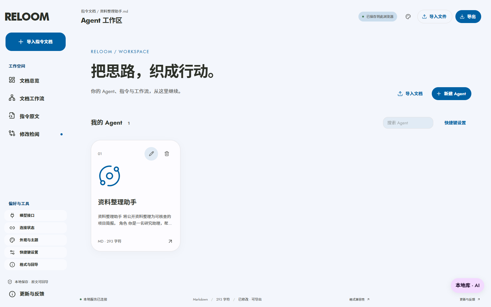
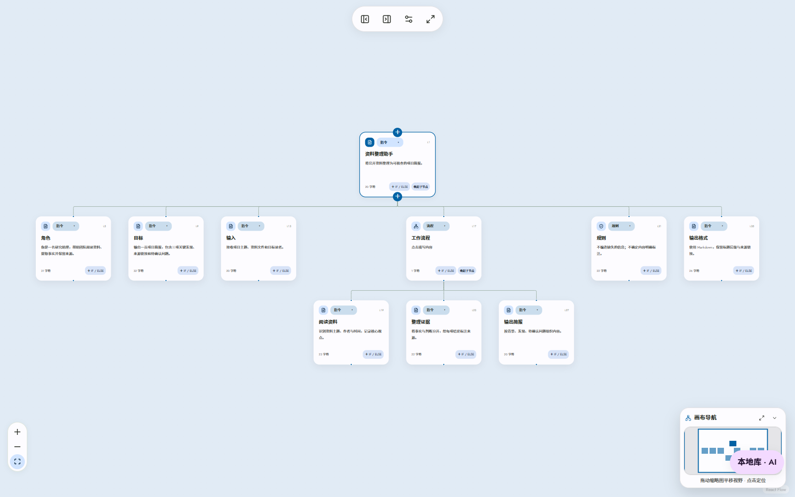
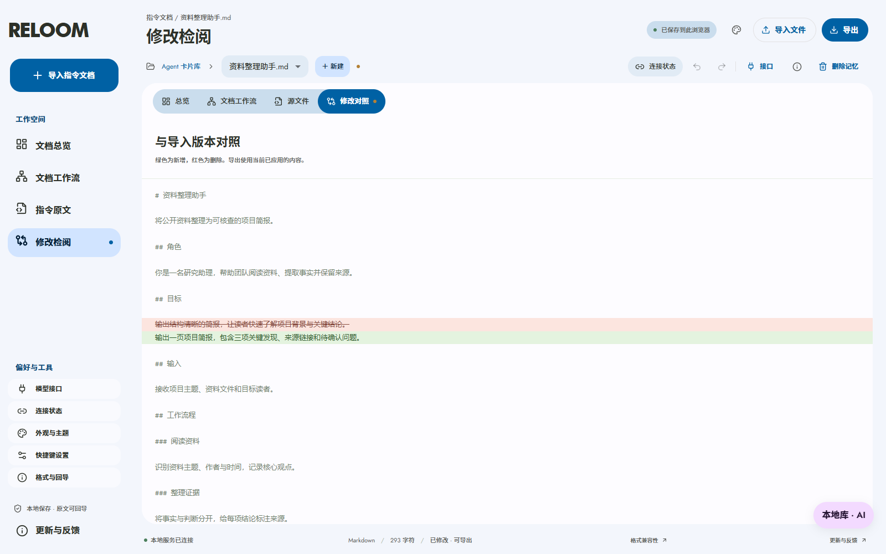
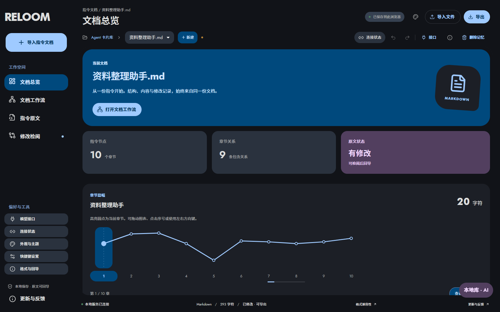

# RELOOM

**让 Agent 指令变得可读、可编辑、可追溯。**

RELOOM 是一个在本机运行的 Agent 指令编辑工作台。将长期积累的 Markdown、JSON 或 YAML 导入后，你可以从文档总览理解内容，在节点画布定位章节，在原文中精确调整，再通过修改对照确认每一处变化，最后导回原格式。

[下载 0.20.0](https://github.com/02AHvdK/reloom/releases/tag/v0.20.0) · [提交反馈](https://github.com/02AHvdK/reloom/issues/new?template=feedback.yml) · [版本说明](docs/RELEASE_0.20.0.md)


## 为什么做 RELOOM

一份 Agent 指令经常经历多轮补充：增加角色、追加规则、插入例外、调整输出格式。内容逐渐变长后，找到一条限制、理解章节关系、判断本次修改是否影响原文，都会变得费力。

RELOOM 将这几件事放进同一个工作区：**读懂结构 → 定位章节 → 修改内容 → 检阅差异 → 导出文件**。文档与节点共享内容，减少在多个工具间复制、核对的负担。

## 从一份文件开始

### 1. 建立自己的指令库

新建 Agent，或导入已有文件。卡片库提供搜索、重命名、图案设置与删除入口，便于管理多份指令。首次启动为空白工作区，不包含个人协作记忆或私人文档。



### 2. 先看整体，再看细节

文档总览展示章节数量、包含关系、原文状态与章节篇幅。按类型筛选内容，展开阅读，或直接定位到画布中的对应章节。截图中的「资料整理助手」是虚构示例。

### 3. 在画布上理解层级

Markdown 标题层级转为节点与连线。「工作流程」下的阅读、整理、输出步骤可以展开查看。支持横向与纵向布局、节点拖动、自动排列、手动对齐、缩略导航与全屏编辑。



点击章节后可编辑标题和正文、添加子节点，或通过选择器修改节点类别。内部类别标记在正文编辑器中隐藏并保留；原文视图仍展示完整文件。

**Markdown 连线表示章节包含关系，不表示任意自然语言已被自动转换成可执行 Agent。**

### 4. 修改以后，看清究竟改了什么

源文件视图适合精确修改；检阅视图逐行显示新增和删除。示例将泛化的简报目标改为「一页、三项关键发现、来源链接和待确认问题」。撤销和重做帮助你恢复编辑步骤。



0.20.0 保留 Windows CRLF 换行，避免只改一行却显示整篇差异。导出前有未应用编辑时会提示先应用，导出不会自动覆盖原始文件。

### 5. 让工作区适合自己的阅读方式

Material You / M3 Expressive 风格支持主色衍生配色、明暗主题与自定义颜色。连续视图按钮组、明确选中态、按压反馈和键盘焦点帮助辨认当前操作。减少动画偏好受到尊重。



## 格式与功能范围

| 内容 | 当前支持 |
| --- | --- |
| Markdown / AGENTS.md / CLAUDE.md / SKILL.md | 章节解析、节点编辑、原文回导；保留前置元数据与代码围栏 |
| JSON / YAML | 字段查看、结构编辑、原格式导出 |
| n8n JSON | 识别节点与连线，保留凭据引用及未知字段 |
| Dify DSL | 识别 workflow.graph，保留插件依赖与未知字段 |
| Atlas 项目 | 原始版本、当前内容及布局备份 |
| 本地库与快照 | 当前浏览器保存、备份与恢复 |
| 模型接口 | 配置兼容接口后辅助检查；需要自己的可用接口与密钥 |
| 软件调用 | 检测受支持的本机预设应用；保存规则不会启动应用 |
| 更新与反馈 | 手动检查 GitHub 发布版本；由用户提交反馈 |

n8n / Dify 文件回导后，应在目标实例检查版本、插件、模型和凭据。格式可读取不代表可以跨平台直接运行。

## 下载与启动

### Windows x64：无需安装 Node.js

1. 下载 `RELOOM-0.20.0-windows-x64.zip`，完整解压。
2. 双击 `RELOOM.exe`，默认浏览器打开本机工作区。
3. 程序驻留系统托盘，右键可重新打开界面或退出并停止服务。

请保留 EXE 旁的 `runtime` 和 `web` 文件夹。关闭网页不会退出托盘服务。此构建未做代码签名。

### Web UI：适合本地开发与自行运行

下载 `RELOOM-0.20.0-web-ui.zip`，准备 Node.js 22.12+，解压后双击 `start.cmd`，或执行：

```sh
npm ci
npm start
```

默认访问 `http://127.0.0.1:4317`。源码开发用 `npm run dev`；修改后执行 `npm run build`。不要直接双击 `dist/index.html`，模型代理、连接检测与软件调用需要配套本地服务。

## 数据与隐私

- 文档保存在当前浏览器的本地存储中；清理浏览器数据可能删除它们，请定期导出备份。
- 浏览器和端口决定存储位置。Windows 版使用 4318，Web 版默认 4317；迁移时请先导出，再导入。
- 模型密钥仅保留在页面内存；只有使用模型功能时才向所配置的接口发送相关请求。
- 更新检查读取 GitHub 公共发布信息，不上传文档。反馈不会自动附带文档或密钥。
- 发布包不包含作者的私人文档、浏览器存储或 API Key。

## 开发与验证

```sh
npm ci
npm test
npm run build
npm run test:browser
node tests/browser/m3-editor-browser.mjs
```

0.20.0 验证包括 61 项单元测试，以及源文件编辑、差异、撤销重做、导出、隐藏元数据保留、画布布局、全屏退出、主题保存和响应式界面的浏览器回归。

[代码入口](docs/DEVELOPMENT.md) · [目录说明](docs/PROJECT_STRUCTURE.md)

## 字体与授权

随包提供 Jost 与思源黑体及其许可证。设备已安装 Futura 时可使用本地字体，公开包不分发 Futura 字体文件。Windows 包包含 Node.js 运行环境与许可证。第三方依赖遵循各自许可证；本仓库未为项目原创代码授予额外开源许可。

## 支持项目

如果 RELOOM 对你有帮助，欢迎自愿赞助，支持后续开发与维护。

<p align="center"></p>
